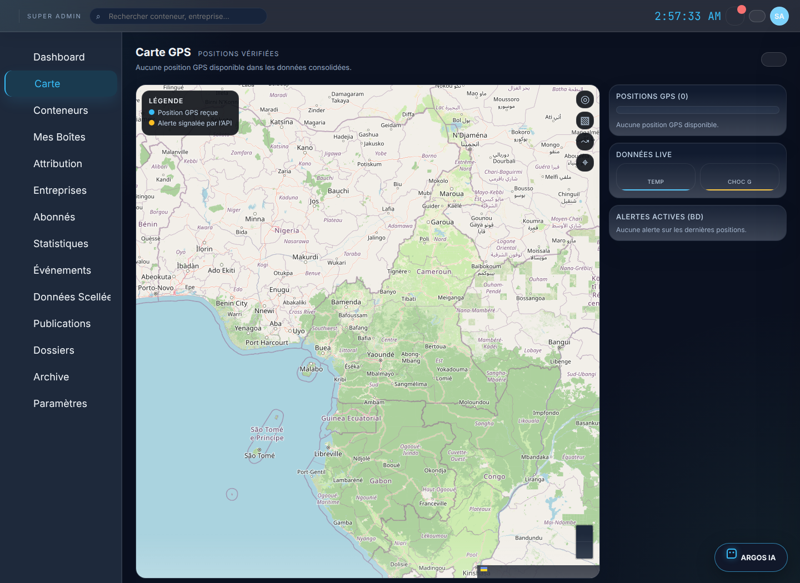
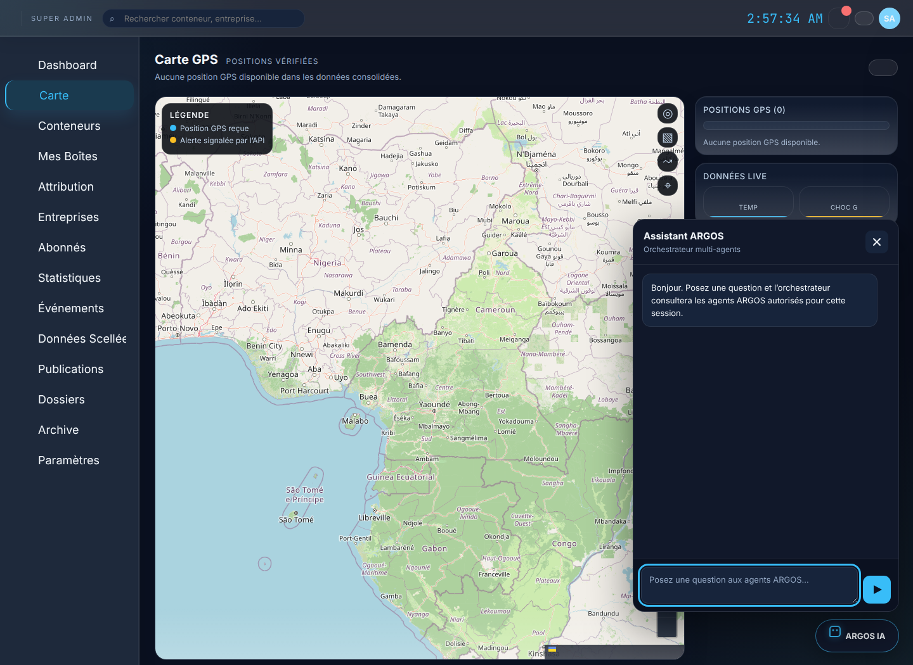
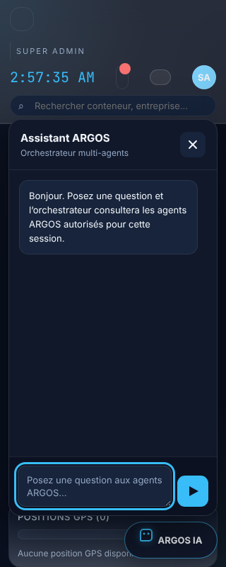

# Phase 3 — Point de contrôle

Date : 27 octobre 2026. Périmètre : carte GPS sur les API consolidées et bulle IA globale connectée à l’orchestrateur de phase 2. Aucun travail de phase 4 n’a commencé.

## Réalisé

- La carte utilise `/api/containers/positions` comme source des coordonnées et rejette les positions hors plage ou incomplètes. Les métadonnées de `/api/containers/all` servent uniquement à afficher un libellé de boîte déjà présente dans la réponse GPS filtrée par rôle.
- Les traces demandent l’historique autorisé `/api/black-boxes/<id>/history`. Les coordonnées en mémoire et l’ancienne route générique d’événements ne servent plus au placement GPS.
- L’interface couvre les états de chargement, d’erreur et d’absence de position; elle n’ajoute aucun marqueur de démonstration. Une recherche, une actualisation, le recentrage, le changement de fond et les traces sont accessibles au clavier.
- La bulle IA est disponible globalement après connexion et envoie uniquement la question et l’identifiant de boîte facultatif à `/api/ai/chat` via `secureApiFetch`. La réponse affiche le texte, les agents, leurs statuts, les échanges de résultats, les sources et l’identifiant de trace.
- Les fonds de carte ont leurs attributions visibles; OpenStreetMap utilise l’URL standard prescrite par sa politique officielle et n’est chargé que pour l’étendue affichée. [Politique officielle d’utilisation des tuiles OSM](https://operations.osmfoundation.org/policies/tiles/).
- Les contrôles sont adaptés aux écrans étroits, le panneau IA se ferme avec Échap et rend le focus à son bouton. La préférence de mouvement réduit est respectée.

## Tests et observations

- `node --check` sur `core-state.js`, `data-pages.js`, `ui-navigation.js` et `auth-qr.js` : réussi.
- `node --test tests/js/phase3-ui.test.cjs` : **3 réussis** (normalisation GPS, raccordement global et rendu des agents, échanges, sources et trace).
- `PYTHONDONTWRITEBYTECODE=1 /tmp/argos-phase2-venv/bin/python -m pytest -q tests` : **4 réussis**, dont le test phase 2 où Gemini appelle plusieurs agents dans un même tour et reçoit leurs résultats avant sa réponse finale.
- Capture Playwright de l’interface servie localement : aucune erreur JavaScript; page GPS reconnue, zéro marqueur; panneau IA ouvert et fermé par Échap; focus rendu au bouton; panneau contenu dans une fenêtre de 320 × 800.
- Test Playwright complémentaire avec une réponse IA de test : le navigateur transmet uniquement `message` et `black_box_id` via l’appel authentifié, puis rend le résultat d’orchestration, les agents consultés, les échanges, les sources et la trace. La réponse simulée sert à vérifier l’affichage; les tests Python de phase 2 vérifient la coordination côté serveur.
- Les routes réelles interrogées par le serveur local ont répondu 200 avec **0 position** et **0 conteneur**. Les captures montrent donc l’état vide réel, sans positions inventées.

Le serveur de capture temporaire (`127.0.0.1:5099`) a injecté une identité superadmin de test et désactivé le contrôle d’identité uniquement dans ce processus local; les handlers Flask et leur accès aux données n’ont pas été simulés. Ce dispositif ne valide pas l’authentification de production. Aucun appel réel au fournisseur LLM n’a été lancé; la coordination multi-agents est couverte par les tests de phase 2 à transport simulé.

## Captures

## Fichiers concernés

`app/static/js/core-state.js`, `app/static/js/data-pages.js`, `app/static/js/ui-navigation.js`, `app/static/js/auth-qr.js`, `app/static/js/script.js`, `app/static/css/style.css`, `app/templates/index.html`, `tests/js/phase3-ui.test.cjs` et les captures ci-dessus.
